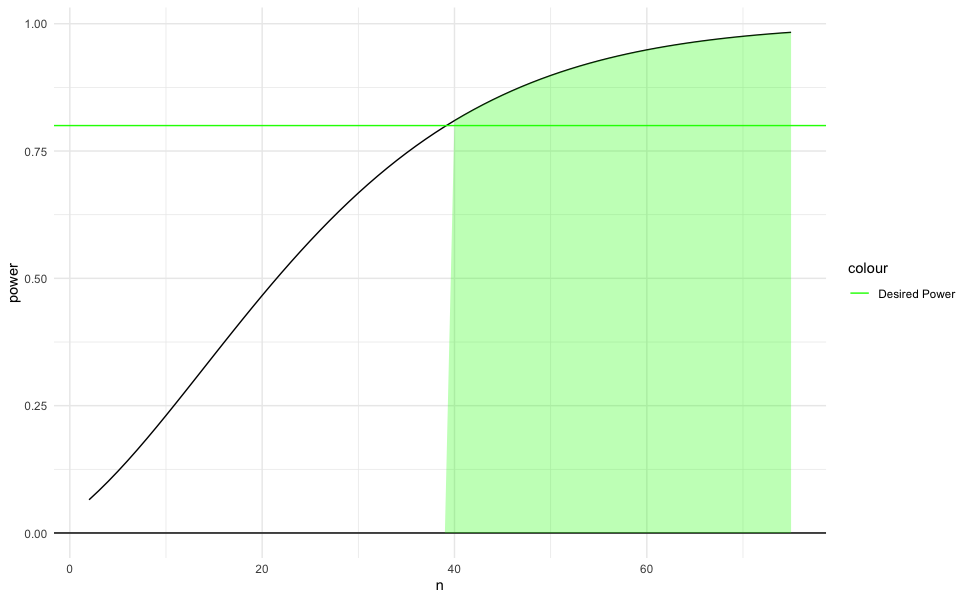
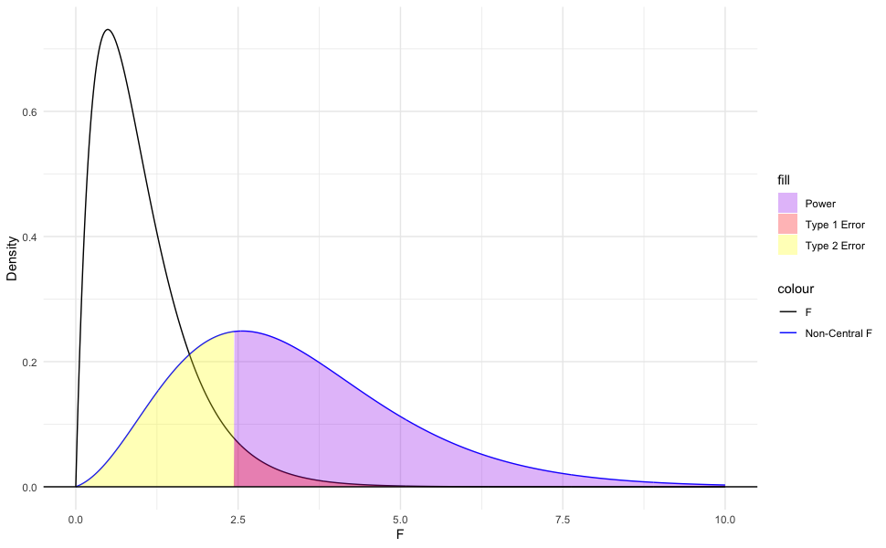
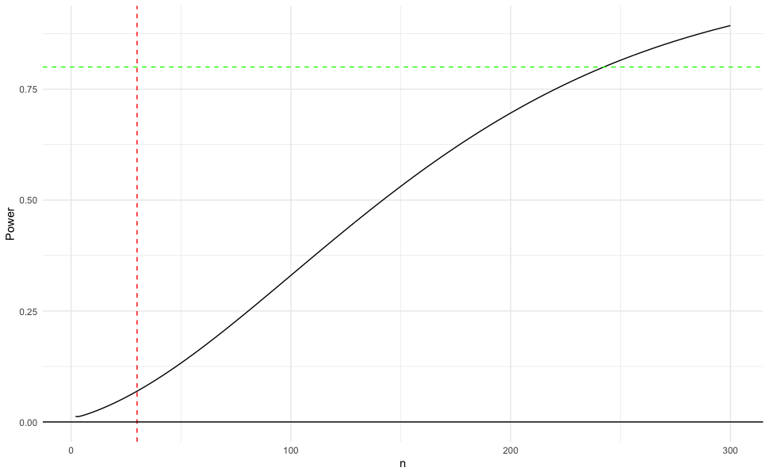

```{r}
#| echo: false

default_chunk_hook  <- knitr::knit_hooks$get("chunk")

latex_font_size <- c("Huge", "huge", "LARGE", "Large", 
                     "large", "normalsize", "small", 
                     "footnotesize", "scriptsize", "tiny")

knitr::knit_hooks$set(chunk = function(x, options) {
  x <- default_chunk_hook(x, options)
  if(options$size %in% latex_font_size) {
    paste0("\n \\", options$size, "\n\n", 
      x, 
      "\n\n \\normalsize"
    )
  } else {
    x
  }
})
```

```{r}
#| label: load-packages\
#| include: false
library(tidyverse)
library(patchwork)
library(rstatix)
```

# Question 1: Why do we Correct for Multiple Comparisons?
A student asked me what the point of correcting for multiple comparisons was. They made a two interesting points:

1. They are different outcomes, so, unlike the coin flip example (where the coin is the same) it doesn't makes sense to combine them.
2. If a manuscript presented three studies with $t$-tests, they don't correct for multiple comparisons across *those* tests.

When we conduct all pairwise comparisons after an omnibus test like ANOVA, we are testing a single family of hypotheses to answer one overarching question ("Which of these groups are different?"). Every additional test provides another opportunity to commit a Type I error from random noise. Similar to the coin, the probability of making at least one false error across $J$ independent tests grows exponentially: $1 - (1 - \alpha)^J$. Note that our pairwise comparisons are not independent, so it's slightly different.

We don't correct for inferences across separate studies because they typically test distinct hypotheses using independent samples. Our attempt to address the multiple comparisons problem is specifically confined to the issue of increased Type I error within a single decision-making context. If we don't, we can find ourselves in a $p$-hacking-like situation, where an investigator might search through many tests to find one $p < 0.05$ (a potential false discovery), rather than making decisions to best position themselves for finding a true discovery.

Here, we will quickly demonstrate why we correct for the multiple comparisons problem when conducting several tests to answer the same question. 

## Part a
Complete the following steps in $R=1000$ simulations.

1. Simulate data for $k=5$ samples $n=30$ drawn from a standard Gaussian distribution.
2. Use `pairwise.t.test(..., p.adjust.method="none")` to compute unadjusted pairwise $t$-tests and record if any comparison yields statistically discernible support for a non-zero mean.
3. Use `rstatix::tukey_hsd(...)` to compute the Tukey's HSD adjusted pairwise tests and record if any comparison yields statistically discernible support for a non-zero mean.

In the end, describe the Type I error rates.

```{r}
#| cache: true
n = 30
k = 5
R = 1:1000


significance.dat = tibble(simulation = R, unadjusted = rep(NA, 1000), adjusted = rep(NA, 1000))

for(i in R){
  dat = tibble(
    value = rnorm(n * k),
    group = as.factor(rep(1:k, each = n))
  )
  unadjusted = pairwise.t.test(dat$value, dat$group, p.adjust.method = 'none')
  adjusted = rstatix::tukey_hsd(dat, value ~ group)

  significance.dat$unadjusted[i] = any(unadjusted$p.value < 0.05, na.rm = TRUE)
  significance.dat$adjusted[i] = any(adjusted$p.adj < 0.05)
}

t1.unadj = length(which(significance.dat$unadjusted == TRUE))/length(R)
t1.adj = length(which(significance.dat$adjusted == TRUE))/length(R)
```

This simulation resulted in a type 1 error of $`r t1.unadj*100`\%$ for the unadjusted t-tests, and a type 1 error. of $`r t1.adj*100`\%$ for the adjusted t-tests. This makes sense because without adjusting for Family Wise Error Rate (FWER) we expect the error rate to be $\alpha \times k$ ($0.05\times 5 = 0.30$), which is exactly what we see in the simulation. When adjusting we expect the FWER to be $\alpha$, and in this case the adjusted rate is approximately $\alpha = 0.05$. 

## Part b
Redo the simulation, changing to adjust according to the false discovery rate `p.adjust.method="BH"` and comment on the differences.

```{r}
#| cache: true
n = 30
k = 5

BH = rep(NA, 1000)

R = 1:1000
for(i in R){
  dat = tibble(
    value = rnorm(n * k),
    group = as.factor(rep(1:k, each = n))
  )
  bhadjust = pairwise.t.test(dat$value, dat$group, p.adjust.method = 'BH')

  BH[i] = any(bhadjust$p.value < 0.05, na.rm = TRUE)
}

t1.BH = length(which(BH == TRUE))/length(R)
```

Running the simulation again while using the 'BH' adjust method yields a type 1 error of $`r t1.BH*100`\%$ which is what we would expect for the adjusted FWER.

# Question 2: Power Analyses
Revisit the MFAP4 study from class. 

## Part a
Assume the researchers were targeting a moderate effect size of Cohen's $f = 0.25$, setting significance level $\alpha = 0.05$ and desired power $1 - \beta = 0.80$. Were they adequately powered?

**Note**: The actual effect size is $f=0.55$, but researchers usually do not know that ahead of time and defaulted to moderate, instead of specifying a large effect.

What is the required sample size per group ($n$) and the overall total sample size ($N$)? Write the `R` code using the `pwr` package to calculate this sample size. This package assumes all samples are of the same size so $N=nk$, where $k$ is the number of samples. Note that the best answers will have a corresponding graphical display.

```{r}
#| output: false
library(pwr)
k = 5
f = 0.25
alpha = 0.05
power = 0.8

anova.power = pwr::pwr.anova.test(k = k, f = f, sig.level = alpha, power = power)

n = ceiling(anova.power$n)
N = n*k

power.dat = tibble(n = 2:75, power = rep(0, 74))

for(i in 2:75){
  power.dat$power[i-1] = pwr::pwr.anova.test(k = k, n = i, f = f, sig.level = alpha)$power
}

ggplot(data = power.dat)+
  geom_line(aes(x = n, y = power))+
  geom_hline(aes(color = "Desired Power", yintercept = 0.8))+
  geom_hline(yintercept = 0)+
  geom_ribbon(aes(ymin = 0, ymax = ifelse(power>=0.8,power,0), x = n), fill = "green", alpha = 0.3)+
  scale_color_manual(values = c("Desired Power" = "green", "Desired n" = "blue"))+
  theme_minimal()
```

:::{.columns}
:::{.column width="75%"}

:::
:::{.column width="25%"}
This graph shows the relationship between the group sample size ($n$) and power. As $n$ increases power increases aswell. On the graph the calculated n required to get power of atleast $80\%$ (marked in green) is shown by the green shaded region.
:::
:::

Using the `pwr` package I was able to run the simulation above showing what group sample sizes will achieve what power. Additionally I calculated the required group sample size ($n = `r n`$) to achieve a power of $0.8$ and total sample size ($N = `r N`$) assuming each group has the same sample size.


## Part b
The project was funded by several agencies. Suppose that a funding agency suggested funding limiting the researchers to $N=150$. Evaluate this suggestion in the context of the ANOVA. Would that be large enough to be adequately powered?

Compute the non-centrality parameter 
$$\lambda = k \cdot n \cdot f^2$$
and use the non-central $F$ distribution to compute the power under $H_a$ for Cohen's $f = 0.25$.  Calculate the statistical power achieved under this budget constraint. Note that the best answers will have a corresponding graphical display.

```{r}
#| output: false
N = 150
k = 5
n = N/k
f = 0.25

lambda = N*(f^2)

F = qf(0.95, k-1, N-k)
power = pf(F, k-1, N-k, ncp = lambda, lower.tail = FALSE)

f.dat = tibble(f = seq(0, 10, length.out = 1000)) |>
  mutate(density1 = df(f, k-1, N-k, lambda),
         density2 = df(f, k-1, N-k))

ggplot(data = f.dat)+
  geom_line(aes(x = f, y = density1, color = "Non-Central F"))+
  geom_line(aes(x = f, y = density2, color = "F"))+
  geom_ribbon(aes(ymin = 0, ymax = ifelse(f > F, density1, 0), x = f, fill = "Power"), alpha = 0.3)+
  geom_ribbon(aes(ymin = 0, ymax = ifelse(f < F, density1, 0), x = f, fill = "Type 2 Error"), alpha = 0.3)+
  geom_ribbon(aes(ymin = 0, ymax = ifelse(f > F, density2, 0), x = f, fill = "Type 1 Error"), alpha = 0.3)+
  geom_hline(yintercept = 0)+
  labs(y = "Density", x = "F")+
  scale_color_manual(values = c("Non-Central F" = "blue", "F" = "black"))+
  scale_fill_manual(values = c("Power" = "purple", "Type 1 Error" = "red", "Type 2 Error" = "yellow"))+
  theme_minimal()
```

:::{.columns}
:::{.column width="75%"}

:::
:::{.column width="25%"}
This graph shows the central F-distribution with parameters $\text{df}_1 = `r k-1`$ and $\text{df}_2 = `r N-k`$ and the non central F-distribution with the same degrees of freedom and non centrality parameter $\lambda = `r round(lambda, 2)`$, calculated for an effect size $f = `r f`$. Using the critical F calculated in the code above ($F_{\textit{critical}} = `r round(F, 2)`$), the graph displays the power, and the type 1 and 2 errors if the total sample size were $N = 150$.
:::
:::

By computing the non centrality parameter $\lambda = `r round(lambda, 2)`$, and the critical F statistic $F_{\textit{critical}} = `r round(F, 2)`$, I was able to compare the central F-distribution with the noncentral F-distribution which we assume is the population distribution. With $\alpha = 0.05$ and effect size $f = 0.25$, the expected power for a sample size $N = 150$ is $`r round(power, 2)`$. This is not sufficient because it is less than the desired power $0.8$

## Part c
In the article the researchers state:

> *However, the statistical power was not sufficient to allow an accurate discrimination of no to moderate stages of hepatic fibrosis (F0–F2) from severe fibrosis and cirrhosis (F3 and F4).*

The European Association for the Study of the Liver (EASL) provides treatment recommendations based on these stages. 

* Stages 0-1: Treatment is deferred with regularly assessment
* Stage 2: Treatment is justified for those in stage 2
* Stage 3-4: Treatment is a priority for those in stages

Suppose the researcher wanted to perform a follow-up test where they want to ensure adequate power not just for the overall ANOVA $F$-test, but specifically to detect a pairwise differences between stages 1 and 2. Explain why the sample size computed in Part a may not be enough and use `PMCMRplus::power.tukey.test()` to compute a sample size that attains adequate power. 

**Note**: The researchers would have had to do this *a priori*. Because we aren't medical experts, you can use sample estimates using the original data.
\begin{align*}
  n & = \text{answer from part a}\\
  \mu_{\Delta} & = 0.25 \\ 
  \sigma^2_{\text{pooled}} & = \frac{(176-1)0.85^2 + (135-1)0.84^2}{176+135-2} = 0.7152\\
  \sigma_{\text{within}}= 0.77
\end{align*}

```{r}
#| output: false
#| cache: true
library(PMCMRplus)
n = 30
k = 5

power1 = PMCMRplus::power.tukey.test(n = n, groups = k, delta = 0.25, within.var = 0.77^2)$power
power = 0

while(power < 0.8){
  n = n + 1
  power = PMCMRplus::power.tukey.test(n = n, groups = k, delta = 0.25, within.var = 0.77^2)$power
}

power.dat = rep(0, 299)

pair.power = tibble(n = 2:300)

for(i in pair.power$n){
  power.dat[i-1] = PMCMRplus::power.tukey.test(n = i, groups = k, delta = 0.25, within.var = 0.77^2)$power
}

pair.power = pair.power |>
  mutate(power = power.dat)

ggplot(data = pair.power)+
  geom_line(aes(x = n, y = power,))+
  geom_hline(yintercept = 0.8, linetype = "dashed", color = "green")+
  geom_vline(xintercept = 30, linetype = "dashed", color = "red")+
  geom_hline(yintercept = 0)+
  labs(x = "n", y = "Power")+
  theme_minimal()
```

:::{.columns}
:::{.column width="75%"}

:::
:::{.column width="25%"}
This graph shows the power of a pairwise test between stages 1 and 2 as the group sample size increases. There is a significant difference in the sample size needed for adequate power between the overall ANOVA F-test and the pairwise test. Shown in [red]{style="color: red;"} is the sample size required for the overall ANOVA test, and shown in [green]{style="color: lightgreen;"} is the desired power ($0.8$). As you can see the with $n = 30$ the power of the pairwise test is only $`r round(power1, 2)`$ and at power $= 0.8$ the sample size would have to be $n = `r n`$.
:::
:::

The sample size originally calculated in part a ($n = 30$) may not be enough for the pairwise comparison because the overall ANOVA test tests the if all 5 means are the same, but the pairwise test compares only two means. Thus, more data would be required to test the difference of two means. Using `PMCMRplus::power.tukey.test` from the I calculated that a sample size of $n = `r n`$ is required to achieve power $= 0.8$. This is greater than $8$ times the sample size calculated in part a.


## Part d
How does the answer to Part c change if they wanted to have adequate power for *all* pairwise comparisons? Use `Superpower::ANOVA_design()` to set up the ANOVA set up.

**Note**: Use design "5b" and the following.
\begin{align*}
  \boldsymbol{\mu} &= \{2.92, 3.11, 3.36, 4.04, 4.35\}\\
  \sigma^2 &= \frac{(97-1)0.87^2 + (176-1)0.85^2 + (135-1)0.84^2 + (67-1)1.00^2 + (67-1)0.90^2}{97+176+135+67+67-5} = 0.80
\end{align*}

Compute the power of the researcher's design (part a) using `Superpower::ANOVA_power()`. If the researchers were able to oversample by double, a common approach to addressing this issue, would their power be at least 80% for all pariwise comparisons?

**Note**: This code can take a minute. You may want to set `cache: true` in your `R` chunk yaml header. You will also see more power because the actual effect size was 0.55.

```{r}
#| cache: true
#| output: false
library(Superpower)
n = 30
k = 5
anova1 = Superpower::ANOVA_design(design = "5b", n = n, mu = c(2.92,3.11,3.36,4.04,4.35), sd = sqrt(0.8))
power1 = Superpower::ANOVA_power(anova1, alpha_level = 0.05)
anova2 = Superpower::ANOVA_design(design = "5b", n = n*2, mu = c(2.92,3.11,3.36,4.04,4.35), sd = sqrt(0.8))
power2 = Superpower::ANOVA_power(anova2, alpha_level = 0.05)

stages = c("Stage 0", "Stage 1", "Stage 2", "Stage 3", "Stage 4")
comparisons = rep("", 10)
index = 1;
for(i in 1:(length(stages)-1)){
  for(k in (i+1):length(stages)){
    comparisons[index] = paste(stages[i], stages[k], sep = " vs ")
    index = index + 1
  }
}


comp.dat = tibble(Comparison = comparisons, Original = power1$pc_results$power, Double = power2$pc_results$power)|>
  add_row(Comparison = "Overall", Original = power1$main_results$power, Double = power2$main_results$power, .before = 1)

underpowered = comp.dat |>
  filter(Original < 80)
```

|Comparison         | Original| Double|
|:------------------|--------:|------:|
|Stage 0 vs Stage 1 |     $12.2\%$|   $22.4\%$|
|Stage 0 vs Stage 2 |     $48.9\%$|   $79.2\%$|
|Stage 1 vs Stage 2 |     $20.4\%$|   $34.9\%$|
|Stage 3 vs Stage 4 |     $27.3\%$|   $47.6\%$|

Using `Superpower::ANOVA_design()` and `Superpower::ANOVA_power()`, I calculated the power of each comparison for both $n=30$ (the original sample size) and $n=60$ (double sample size). In the table above are the comparisons where $\text{power} < 80\%$ for the , all other comparisons had sufficient power. As shown in the table above, all four comparisons that were underpowered at $n=30$ are still underpowered at $n=60$.

# Question 3: An Application
@Yang23 investigate whether low-dose nicotine can counteract age-related metabolic decline. The proposed mechanism is through $\text{NAD}^+$, which is a chemical compound essential for metabolic energy production. The idea is that low-dose nicotine could help improve and/or maintain the recycling of $\text{NAD}^+$ by activating the salvage enzyme NAMPT via SIRT1. This could, in turn, restore $\text{NAD}^+$ homeostasis, which is the biological balance maintained within a cell between the production, recycling, and degradation of nicotinamide adenine dinucleotide ($\text{NAD}^+$).

**Note:** It is low-dose nicotine. Cigarette smoking delivers massive doses of nicotine along with other harmful chemicals. This is not an endorsement for smoking. 

Male mice across distinct life stages -- 2, 6, and 16 months -- were categorized to evaluate natural, age-dependent metabolic and enzymatic shifts in two conditions.

* Treatment: low-dose nicotine (administered in drinking water)
* Control: no-dose placebo (administered in drinking water)

The researchers then aimed to compare treatment against control in the following samples:

* 2 months old, control
* 6 months old, control
* 16 months old, control
* 16 months old, treatment

Using PET imaging, the researchers measured age-induced inflammatory glucose hypermetabolism ($\text{SUV}_{\text{max}}$). They want to show that this quantity increases with age and those in the nicotine group saw levels comparable to younger mice.

| Replicate | 2M | 6M | 16M | 16M, Treatment |
|:---|:---:|:---:|:---:|:---:|
| 1 | 1.48969 | 4.36000 | 7.30182 | 4.69304 |
| 2 | 1.30168 | 4.28807 | 7.12416 | 2.51326 |
| 3 | 1.30620 | 3.64184 | 8.28764 | 2.38019 |

: $\text{SUV}_{\text{max}}$ measurements in the heart across age and treatment groups {#tbl-SUV}

## Part a
State the null ($H_0$) and alternative ($H_a$) hypotheses for the omnibus test.

$$
H_0 : \mu_{2M} = \mu_{6M} = \mu_{16M} = \mu_{16M,\textit{ treatment}} \\
H_a : \text{Atleast one mean differs}
$$


## Part b
Perform some exploratory data analysis to provide empirical information about the researchers question.

|Group     | mean|   sd|
|:---------|----:|----:|
|16M, Treatment | 3.19| 1.29|
|16M       | 7.57| 0.62|
|6M        | 4.09| 0.39|
|2M        | 1.36| 0.10|

The table above shows the means and standard deviations of each group. Empirically it seems as if groups 2M, 6M, and 16M are not within $2$ standard deviations of eachother, so there may be a significant difference in $\text{SUV}_{\text{max}}$ across age groups. The treatment group, however, has much higher variability so it is less certain wether the treatment makes a difference.


## Part c
Perform and report the results of the omnibus test. Make sure to evaluate the conditions for using the method you choose.

For this data it makes sense to do an ANOVA test. The conditions for this test are independence, normality, and similar variances. This data meets the independence condition as the reseacrhers made sure their observations across groups were independent. The normality and similar variances assumptions are not met however, as the sample size for each group is only $n = 3$, and the variances are dissimilar. ANOVA is robust to these assumptions so I feel comfortable running the test anyways.

```{r}
mouse.dat = tibble(Replicate = 1:3, `2M` = c(1.48969, 1.30168, 1.30620), 
                   `6M` = c(4.36000, 4.28807, 3.64184), `16M` = c(7.30182, 7.12416, 8.28764),
                    Treatment = c(4.69304, 2.51326, 2.38019))


mouse.long = mouse.dat |>
  pivot_longer(cols = -Replicate, names_to = "Group", values_to = "Value")

mouse.summary = mouse.long |>
  group_by(Group) |>
  summarise(mean = mean(Value), sd = sd(Value))

anova.dat = rstatix::anova_test(mouse.long, Value ~ Group)
```

After organizing the data and using the `rstatix::anova_test()` function, the F-value for the data was $`{r} anova.dat$F`$ and the p value was $< 0.0001$. This tells us that there if we assume the null hypothesis to be true, the probability that we get the data we got is less than $0.01\%$. From the results of this test it can be concluded that there is statistically discernable support that the mean $\text{SUV}_{\text{max}}$ across age groups in mice are not the same.

## Part d
Conduct post-hoc pairwise comparisons to determine if age-induced inflammatory glucose hypermetabolism increase with age and whether low-dose nicotine reduces age-induced inflammatory glucose hypermetabolism. 

The previous test told us there is a difference among the means but it does not tell us how much of a difference, or where the it is. In order to see where the differences lie and how significant they are, I used `rstatix::tukey_hsd` to run a pairwise comparison test on all the groups.

```{r}
#| cache: true
#| output: false
pairwise.test = rstatix::tukey_hsd(mouse.long, Value ~ Group)


power.design = Superpower::ANOVA_design("4b", 3, mouse.summary$mean, mouse.summary$sd)
power.results = Superpower::ANOVA_power(power.design, alpha_level = 0.05)

stages = mouse.summary$Group
comparisons = rep("", 6)
index = 1;
for(i in 1:(length(stages)-1)){
  for(k in (i+1):length(stages)){
    comparisons[index] = paste(stages[i], stages[k], sep = " vs ")
    index = index + 1
  }
}

overall.results = tibble(Comparisons = comparisons, pvalue = paste0(pairwise.test$p.adj*100, "%"), power = paste0(power.results$pc_results$power, "%"))
```

```{r}
#| echo: false
knitr::kable(overall.results)
```

In addition to running the pairwise tests, I also used `Superpower::ANOVA_design()` and `Superpower::ANOVA_power()` to do a power analysis on our tests. As shown in the table above, there is statistically discernible support a difference between the 16M group and all other age groups along with treatment, and a difference between 2M and 6M. These tests also all have sufficient power. There is not support for a difference between 2M vs. treatment and 6M vs. treatment. 

## Part e
Write a short paragraph directly addressing the researcher's hypothesis using your work in (a)-(d).

The researchers hypothesized that low doses of nicotine could counteract age-related metabolic decline. To measure this they looked at age-induced inflammatory glucose hypermetabolism ($\text{SUV}_{\text{max}}$). Their data met the conditions for an ANOVA test, and the results of the test showed that there is a difference in the means of $\text{SUV}_{\text{max}}$ in different age groups of mice and the treatment group. The second post-hoc test, a pairwise test among groups, revealed that there is a significant difference between $\text{SUV}_{\text{max}}$ levels among age groups 2M, 6M, and 16M. Since these comparisons yielded a p-value less than $0.05$ and had power greater than $0.80$, we can conclude that $\text{SUV}_{\text{max}}$ increases with age. The only other pairwise test that was statistically significant was 16M vs treatment. This shows that among the population of mice treated with nicotine, the average $\text{SUV}_{\text{max}}$ at 16 months is lower than the average of mice not treated with nicotine at 16 months. These results provide support for the researchers hypothesis.